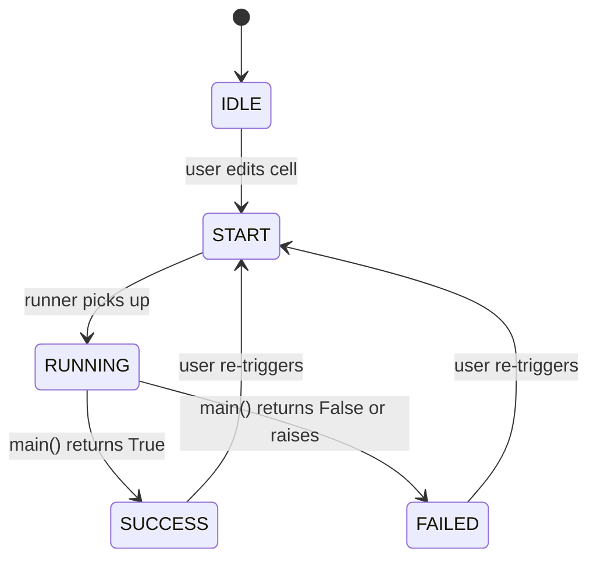

# Architecture

## Components

| Component | Where | Role |
|-----------|-------|------|
| Controller | Google Sheet `RaspPI-Remote-Worker` | Human-facing control panel. Worksheets `Config` and `Log` |
| Worker | `scripts/runner.py` under systemd on the Pi | Polls `Config`, runs scripts whose Status is `START` |
| Sheet client | `scripts/utils/control_panel.py` | `ControlPanel`: auth, reads, status writes, logging, lifecycle |
| Tasks | `scripts/*.py` | One module per task, each exposes `main()` |

Everything that touches Google Sheets goes through `ControlPanel`. Scripts and the runner do not call gspread directly (the exception is `scripts/utils/list_sheets.py`, a standalone diagnostic).

## Status lifecycle

`ControlPanel.execute_script_lifecycle` owns the RUNNING and final transitions. Each transition also appends a row to `Log`. `reset_all_to_idle()` exists for recovery.

## Sheet schema

`Config` (created with headers if missing):

| Column | Header | Notes |
|--------|--------|-------|
| A | Script Name | Matches the file in `scripts/` (`prime_hunter.py`; `.py` optional for loading) |
| B | Status | One of `ScriptStatus` values; column index is hard-coded (2) in `ControlPanel` |
| C | Last Used | Timestamp written on every status change |
| D | Details | Last message |
| E | Priority | Stored, not currently used for ordering |
| F+ | `Parameter-1`, `Parameter-2`, ... | Read via `get_script_parameters_list(script_name)`, sorted by numeric suffix |

`Log`: Timestamp, Script Name, Status, Message, Details (append-only).

Column positions are hard-coded in `set_script_status` and `reset_all_to_idle`. Reordering columns in the live sheet breaks the worker.

## Design decisions

- **Polling, not push.** Simplest thing that works behind home NAT; no inbound ports. Interval is 10 s, 30 s back-off after a runner-level exception.
- **Scripts are imported into the runner process**, not run as subprocesses. A script that hangs blocks the loop; a script calling `sys.exit()` or leaking state affects the runner. Scripts run sequentially. Changing to subprocess/multiprocessing is an "ask first" change (README lists multiprocessing as future work).
- **Return tuple instead of exceptions** as the script result, so the sheet gets a human-readable message and details. Exceptions are still caught and reported as FAILED.
- **Service account auth via `credentials.json`** with `oauth2client` + `gspread.authorize`. Legacy but working; migrating to `gspread.service_account` is a possible cleanup, not a drive-by change.
- **Parameters live in the sheet**, so changing a run's inputs needs no deploy.
- **systemd owns persistence**: `Restart=always`, `RestartSec=10`, log to `logs/service.log`.
