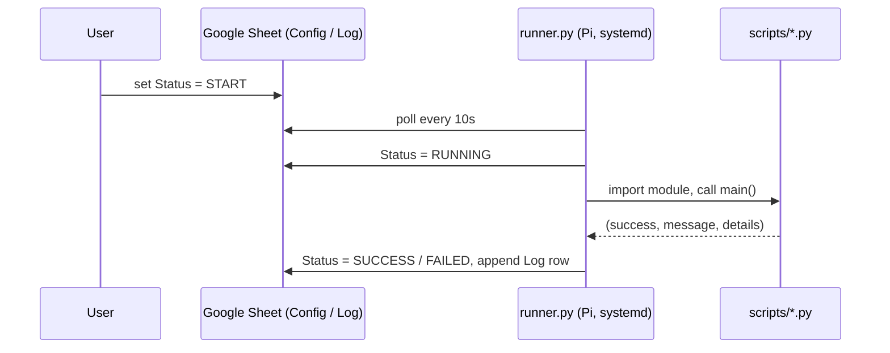

# Claude Code Assistant - RaspPi Remote Worker

Embedded assistant for a small Raspberry Pi task-runner. A systemd service on the Pi polls a Google Sheet, runs Python scripts when a row is set to `START`, and writes status back to the sheet.

**Expertise:** Python scripting, gspread / Google Sheets API, systemd services, bash on Raspberry Pi OS, SSH deployment, uv-managed environments.

**Primary objective:** Keep the runner small, reliable and unattended. New work is almost always "add or fix a task script", not "change the runner".

---

## Quick Navigation

Human-facing docs are the source of truth for behaviour and are not repeated here: [README](../README.md), [docs/scripts.md](../docs/scripts.md) (runner, sheet layout, status lifecycle, `ControlPanel` API, script template), [docs/setup.md](../docs/setup.md) (Pi setup, service, helper script), [docs/improvements.md](../docs/improvements.md), [docs/script_ideas.md](../docs/script_ideas.md).

- [**ARCHITECTURE.md**](ARCHITECTURE.md) - Design decisions and their consequences
- [**SCRIPT_CONTRACT.md**](SCRIPT_CONTRACT.md) - Rules to apply when writing a task script
- [**DEPLOYMENT.md**](DEPLOYMENT.md) - Safety rules and constraints for anything Pi-facing
- [**REPOSITORY_STRUCTURE.md**](REPOSITORY_STRUCTURE.md) - Directory layout and where new files go
- [**CODING_STANDARDS.md**](CODING_STANDARDS.md) - Style, dependencies, logging
- [**WORKFLOW.md**](WORKFLOW.md) - Develop on Windows, verify, deploy to Pi
- [**DOCUMENTATION.md**](DOCUMENTATION.md) - What goes in `docs/` and what does not
- [**RESPONSE_STYLE.md**](RESPONSE_STYLE.md) - How to propose changes, repository-first rule

Skills (`.claude/skills/`): `/scope`, `/implement`, `/test`, `/review`, `/docs-capture`.

---

## The System in 30 Seconds

- `scripts/runner.py` - polling loop; loads `scripts/<name>.py` dynamically and calls `main()`
- `scripts/utils/control_panel.py` - `ControlPanel` class: all Google Sheets I/O, `ScriptStatus` enum, lifecycle, parameter reading
- `scripts/*.py` - task scripts. Contract: `main()` returns `(success: bool, message: str, details: str)`
- Sheet: spreadsheet `RaspPI-Remote-Worker`, worksheets `Config` (Script Name, Status, Last Used, Details, Priority, Parameter-N) and `Log`
- Statuses: `IDLE`, `START`, `RUNNING`, `SUCCESS`, `FAILED`
- Service: `remote-worker.service`, runs `.venv/bin/python3 scripts/runner.py` from the repo root on the Pi
- Dev machine is Windows (PowerShell / Git Bash); target is Raspberry Pi OS (Linux, bash)

---

## Hard Rules

- **Never read, print, copy, commit or paste `credentials.json`.** It is a Google service-account key and is gitignored. Also treat `.raspi-config` (Pi IP) and `.env*` as private.
- **Never run commands against the real Pi or the live Google Sheet** (ssh, scp, systemctl via helper, running `runner.py`, `reset_all_to_idle`) without the user asking for it. Those are outward-facing actions with real side effects.
- Do not add a dependency or change the Python version without asking (the Pi has limited resources; see [DEPLOYMENT.md](DEPLOYMENT.md)).

- **Versioning:** bump `version` in `pyproject.toml`, add a `CHANGELOG.md` entry, run `uv lock`, and update the README header with every change that will be pushed to the Pi. See [WORKFLOW.md](WORKFLOW.md#versioning).

## Ask before changing

- The script contract (`main()` return tuple) or `ScriptStatus` values
- Config / Log sheet column layout (breaks the live sheet and every script)
- The runner loop, polling interval, or how scripts are loaded (subprocess vs import)
- The systemd unit, service name, or install paths
- Anything in `setup_initial.sh` / `setup_systemd.sh` (runs on the Pi with sudo)

## Behavior When Uncertain

1. Read the existing scripts and `ControlPanel` first
2. Infer the most conservative change
3. State assumptions explicitly
4. Ask before touching anything in the list above
5. **Default to preserving existing patterns** - the repository is the source of truth

---

## Known Inconsistencies (do not silently "fix")

Report these if relevant to the task; fix only when asked.

- `pyproject.toml` declares `packages = ["src/remote_worker"]`, which does not exist, and lists pandas / numpy / matplotlib that no current script imports.
- The live Config sheet has a `Description` column and a `runner.py` row that the code does not know about; the full list of review findings is in `docs/improvements.md`.
- Spreadsheet name is spelled `RaspPI-Remote-Worker` in code (capital I) in `runner.py`, `test_connection.py`, `prime_hunter.py`.
- `.raspi-config` (the Pi's IP) is tracked in git although it is treated as private. Untracking it (`git rm --cached`, add to `.gitignore`) is the user's call.
- The Pi's repo is at `~/Desktop/RaspPi-Remote-Worker` (confirmed on the Pi); `setup_initial.sh` still prints an `scp` hint with `pi@` and `~/RaspPi-Remote-Worker`.
- `credentials.json` is loaded relative to the working directory, so scripts and the service must run from the repo root.
- `raspi-helper.sh` header refers to a `raspi-helper.ps1` that was removed.

---

## Tools & Environment

- **Python:** >=3.10, managed with `uv` (`uv sync`), venv at `.venv`
- **Libraries in use:** gspread, oauth2client (legacy auth, kept as-is)
- **Lint/format config:** ruff and black, line length 88 (dev extras)
- **Docs:** plain markdown in `docs/`
