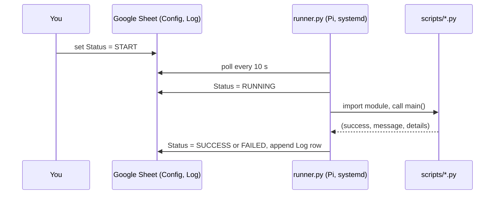

# RaspPi Remote Worker

Version 0.5.1 ([changelog](CHANGELOG.md), [how to bump](docs/scripts.md#versioning)). The version is shown in every update message.

A Raspberry Pi task runner controlled from a Google Sheet. A systemd service on the Pi polls the sheet, runs the Python script named in any row whose status is `START`, and writes the result back. No web UI and no SSH needed to trigger a job: change a cell.

**Control panel:** [Google Sheets dashboard](https://docs.google.com/spreadsheets/d/1d9QU9st_j2gY4Qp7gkhNu5PB016w58sfkjGkW4JydD8/edit?gid=0#gid=0)

## How it works



| Component | What it is |
|-----------|-----------|
| Controller | Google Sheet `RaspPI-Remote-Worker` with a `Config` tab (one row per script, plus `Parameter-N` columns) and a `Log` tab (append-only history) |
| Worker | `scripts/runner.py`, run as `remote-worker.service` so it starts on boot and restarts on failure |
| Sheet client | `scripts/utils/control_panel.py` (`ControlPanel`): all Google Sheets access |
| Tasks | `scripts/*.py`, one module per task, each with a `main()` |

### Status reference

| Status | Meaning |
|--------|---------|
| `IDLE` | Ready (default) |
| `START` | Run me |
| `RUNNING` | Currently executing |
| `SUCCESS` | Last run succeeded |
| `FAILED` | Last run failed or raised |

## Quick start

1. Create the Google Cloud service account, download `credentials.json`, and share the sheet with it.
2. On the Pi: `bash setup_initial.sh`, then `bash setup_systemd.sh`.
3. Copy `credentials.json` to the Pi with `scp` (never through git), then `sudo systemctl start remote-worker.service`.
4. In the `Config` sheet, set `test_connection.py` to `START` and watch the status change.

Full steps: [docs/setup.md](docs/setup.md).

## Adding a script

Create `scripts/my_task.py` with a `main()` that returns `(success, message, details)`, add a row for it in `Config`, set it to `START`. Parameters come from the `Parameter-N` columns. Template and rules: [docs/scripts.md](docs/scripts.md).

## Repository layout

```
scripts/
  runner.py            polling loop and script loader (service entry point)
  utils/control_panel.py   ControlPanel and ScriptStatus
  utils/list_sheets.py     lists sheets the credentials can see
  utils/script_db.py       per-script SQLite databases (data/<script>.db)
  db_report.py             shows what is stored in those databases
  restart_pi.py            restarts the service or reboots the Pi from a sheet cell
  test_connection.py       checks sheet access
  prime_hunter.py          example task with parameters
  git_pull_update.py       pulls the latest code on the Pi from a sheet cell
  pulse_monitor.py         Pi health snapshot (temperature, disk, memory) to a sheet tab and SQLite
  other-ideas.py           notes for future scripts (not runnable)
docs/                  setup, reference, ideas, improvements
setup_initial.sh       Pi first-time install
setup_systemd.sh       installs the systemd service
raspi-helper.sh        SSH helper functions for the dev machine
pyproject.toml         dependencies and the project version
CHANGELOG.md           what changed in each version
credentials.json       service-account key (gitignored, never commit)
logs/                  runtime logs (generated)
data/                  per-script SQLite databases (generated, gitignored)
.claude/               guidance for Claude Code
```

## Documentation

| Doc | Contents |
|-----|----------|
| [docs/setup.md](docs/setup.md) | Google Cloud, flashing and connecting to the Pi, install, service management, helper script, troubleshooting |
| [docs/scripts.md](docs/scripts.md) | Runner behaviour, sheet layout, `ControlPanel` API, writing scripts, the included scripts |
| [docs/faq.md](docs/faq.md) | Quick answers: does the Pi auto-update, what needs a restart, stuck rows |
| [docs/script_ideas.md](docs/script_ideas.md) | Backlog of scripts to try (ideas, not implemented) |
| [docs/improvements.md](docs/improvements.md) | Review findings and proposed changes (not implemented) |
| [docs/knowledge/](docs/knowledge/) | Reference notes: symbolic regression, SD card recovery on Windows |

## Limitations

Scripts run inside the runner process, one at a time, with no timeout, and nothing runs on a schedule. See [docs/improvements.md](docs/improvements.md).

## License

Open source, intended for personal and educational use.
