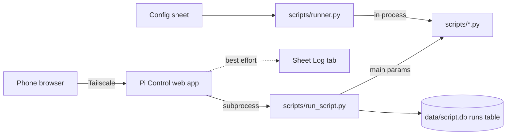

# Pi Control

Pi Control is a web page for running and watching the task scripts on the Pi, as an alternative to the Google Sheet. It is meant to be used from a phone.

**Status: in progress.** The web app works on a laptop (`python debug_control.py`). It is not installed on the Pi yet: that needs Tailscale on the Pi and a systemd service. Sections marked (built) exist in the repo; (planned) ones do not.

## Purpose

The Sheet works, but it is slow and indirect: you edit cells, then wait for the runner to poll (every 10 seconds) and write the result back. Pi Control sends the command straight to the Pi when you press Run, and shows the result, the parameters and the output on one screen.

It does the same job as the Config sheet:

| Config sheet | Pi Control |
|---|---|
| A row per script | A card per script |
| Status (`START`, `RUNNING`, `SUCCESS`, `FAILED`) | A status badge; the Run button replaces setting `START` |
| Last Used, Details | Last run time, last message and details |
| `Parameter-N` cells | Form fields per script, with saved values |
| Log tab | Run history, with the output of each run |
| (none) | Stop button, live output |

The Sheet and its runner keep working unchanged. Either can be used; they are separate front-ends for the same scripts.

## How it fits together



- The web app starts each script as its own process, so it can be stopped and its output read as it is produced. (built)
- The Sheet runner still imports and calls scripts in its own process. (unchanged)
- Both record runs in the script's `runs` table in `data/`, so history is shared.
- Web runs also append a row to the Sheet's Log tab. This is best effort: if the Sheet is unreachable the run and the page are unaffected. (built, not yet checked against the live Sheet)

## What exists now (built)

- **The web app**, in `scripts/web/`: `engine.py` (finding, running, stopping, state), `app.py` (a small JSON API) and `static/index.html` (the page). Run it with `python scripts/web/app.py`, or locally with `python debug_control.py`.
- **State:** saved parameter values and the history of web runs are in `data/pi_control/state.db`; one log file per run is in `logs/`. A lock file in `data/pi_control/locks/` holds the PID of a running script.

- `scripts/run_script.py` runs one script as its own process:
  ```
  python scripts/run_script.py prime_hunter --params '{"start": 1, "end": 50}'
  ```
  It validates the parameters, calls `main(params)`, prints the result, records the run and exits with 0 (succeeded), 1 (failed) or 2 (could not start: unknown script, bad parameters). It refuses `runner` and itself.
- `scripts/utils/params.py` validates and converts parameter values against a script's `PARAMS` list.
- These scripts accept parameters and declare `PARAMS`: `prime_hunter`, `db_report`, `restart_pi`, `pulse_monitor`. `git_pull_update` takes none. `test_connection` still only has its legacy entry point, which `run_script.py` handles.

### Parameters for a script

A script declares what it accepts at module level:

```python
PARAMS = [
    {"name": "start", "label": "Start (inclusive)", "type": "int", "required": True},
    {"name": "mode", "label": "Mode", "type": "choice", "options": ["a", "b"], "default": "a"},
]
CONFIRM = "Shown in an Are you sure? box before this script runs"   # optional

def main(params=None):
    if params is None:
        ...  # started from the Sheet: read Parameter-N as before
    ...      # started from Pi Control: params is a validated dict
    return (success, message, details)
```

Types: `str`, `int`, `float`, `bool`, `date` (YYYY-MM-DD), `choice` (with `options`). Optional keys: `label`, `default`, `required`, `min`, `max`. Unknown names, wrong types and out-of-range values are rejected before the script runs. `main()` with no argument still works for scripts that have not been converted. The return value is unchanged.

## Behaviour (built)

- **Script list:** every `scripts/*.py` that defines `main` (or the legacy `test_sheet_connection`), except `runner` and `run_script`. The files are read, not imported, so `PARAMS`, `CONFIRM` and `TIMEOUT_S` must be plain literal values. Today that is the same set as the Config sheet: `db_report`, `git_pull_update`, `prime_hunter`, `pulse_monitor`, `restart_pi`, `test_connection`.
- **Run:** one tap. Scripts that set `CONFIRM` show an "Are you sure?" box, and the server refuses to run them without confirmation. The values used are remembered per script.
- **Stop:** ends the script and its child processes and records the run as failed ("Stopped by user"). The state shows as "stopped".
- **Output:** live while running (the page polls), kept per run. The last 20 runs and logs per script are kept.
- **No overlap:** a script cannot be started twice from the web app. A Sheet run is not checked against this (planned).
- **Timeout:** 30 minutes by default; a script can set `TIMEOUT_S`. The demo loop script sets it to 10 minutes.
- **Looping scripts** run until stopped.
- **Restart safety:** if Pi Control restarts while a script runs, the script keeps going and is picked up again on startup (it can still be stopped).

## Access and safety

- Reachable only over Tailscale (or localhost while developing). Never exposed to the internet, no Funnel.
- No password: being on the tailnet is the control. Only one user is assumed.
- Only scripts found in `scripts/` can run; there is no way to type a command. Parameters are validated on the server, and passed to the script as JSON, never through a shell.
- Runs as its own low-privilege systemd service, separate from `remote-worker.service`.

## Setup (planned)

1. Install Tailscale on the Pi and sign in; it is already installed on the phone.
2. `git pull` on the Pi, then `uv sync` to install the web dependencies (`fastapi`, `uvicorn`).
3. Install and start the Pi Control service, bound to the Pi's Tailscale address (`<pi-tailscale-ip>`).
4. On the phone, open `http://<pi-tailscale-ip>:8051` and add it to the home screen.

The exact commands go in [setup.md](setup.md) when the service exists.

## Trying it on a laptop (built)

```
python debug_control.py            # demo scripts, throwaway data in data/demo and logs/demo
python debug_control.py --reset    # wipe the demo data first
python debug_control.py --real     # the real scripts and data (they run on this machine)
```

It serves `http://127.0.0.1:8051` (localhost only) and reloads when `scripts/web/` changes, like `debug_ui.py` does for the grid dashboard. Demo mode never touches real history and never contacts the Sheet. The demo scripts in `scripts/web/demo_scripts/` cover a success, a failure, a crash, a slow script with live output, an endless loop (to try Stop), every parameter type, and a confirm box. `--real` does not write to the Sheet's Log tab unless `--sheet-log` is added.

## Not part of this

- The public grid dashboard ([grid.md](grid.md)); that is a separate app.
- Notifications on failure, retiring the Sheet, or multiple users.
