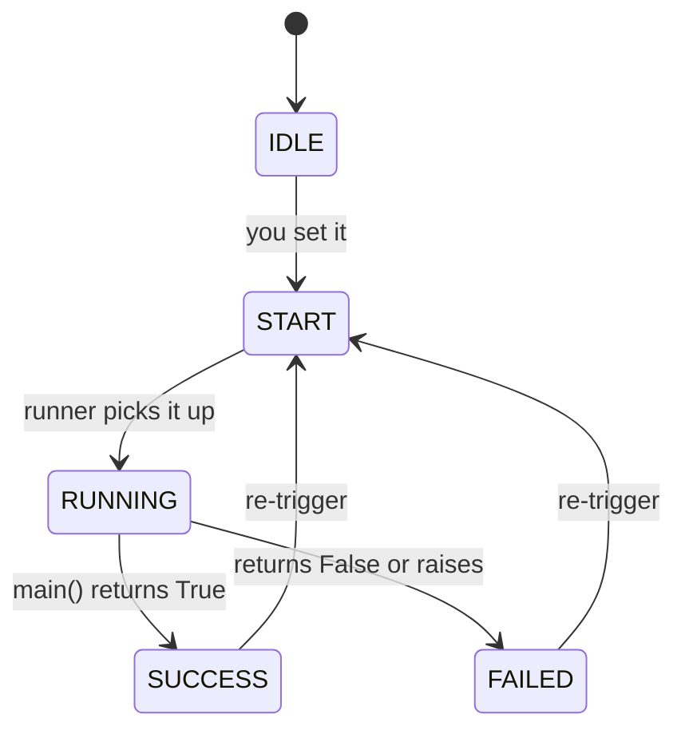

# Runner, sheet and scripts

Reference for how the pieces behave. Setup is in [setup.md](setup.md). Planned changes are in [improvements.md](improvements.md).

## Runner (`scripts/runner.py`)

Loop: every 10 seconds ask `ControlPanel` for rows with status `START`, run each one through `execute_script_lifecycle`, sleep. On an unexpected error in the loop it logs and sleeps 30 seconds. Ctrl+C stops it.

To run one script, `run_script(name)`:

1. strips `.py` and looks for `scripts/<name>.py`
2. imports it with `importlib`
3. calls `main()` (or `test_sheet_connection()` for `test_connection.py`)
4. requires a 3-tuple `(success, message, details)`; anything else is reported as FAILED

Scripts run inside the runner process, one at a time. There is no timeout.

## Sheet layout

Spreadsheet `RaspPI-Remote-Worker`. Both tabs are created with headers if missing.

`Config`:

| Column | Header | Notes |
|--------|--------|-------|
| A | Script Name | File in `scripts/`, e.g. `prime_hunter.py` |
| B | Status | `IDLE`, `START`, `RUNNING`, `SUCCESS`, `FAILED` |
| C | Last Used | Timestamp of the last status change |
| D | Details | Last message |
| E | Description | Free text, ignored by code (added by hand; not created automatically) |
| F | Priority | Stored, not used |
| G+ | `Parameter-1`, `Parameter-2`, ... | Passed to the script as strings |

Columns A-D are addressed by position in code; do not reorder them. Rows are located by searching the whole sheet for the script name, so avoid putting another script's name in Description or Details.

`Log`: Timestamp, Script Name, Status, Message, Details. One row per status change.

## Status lifecycle



## ControlPanel API (`scripts/utils/control_panel.py`)

`ControlPanel(spreadsheet_name, credentials_path="credentials.json", config_sheet_name="Config", log_sheet_name="Log")` authenticates on construction. `credentials_path` is relative to the working directory.

| Method | Purpose |
|--------|---------|
| `get_scripts_to_run()` | Names of rows with status `START` |
| `execute_script_lifecycle(name, func)` | Set RUNNING, call `func()` returning the tuple, set SUCCESS or FAILED, log |
| `get_script_status(name)`, `set_script_status(name, status, message, details)` | Read or update a row and log the change |
| `get_script_parameters(name)` | `{"Parameter-1": "2", ...}` (blank cells skipped) |
| `get_script_parameters_list(name)` | Values ordered by parameter number |
| `get_parameter_headers()` | The `Parameter-N` column names |
| `get_all_scripts()` | All Config rows as dicts |
| `add_script_to_config(name, priority=5)` | Append an `IDLE` row |
| `log_execution(name, status, message, details)` | Append a Log row |
| `reset_all_to_idle()` | Recovery: set every row to `IDLE` |

## Writing a script

1. Create `scripts/my_task.py`.
2. Define `main()` returning exactly `(success: bool, message: str, details: str)`. `message` appears in the Config Details cell; `details` goes to the Log. Return `(False, ...)` for expected failures instead of raising.
3. Read parameters with `get_script_parameters_list("my_task.py")`; they are strings, so convert and validate.
4. Add a row for it in `Config` (status `IDLE`), plus any `Parameter-N` values.
5. Set it to `START`.

```python
#!/usr/bin/env python3
"""One-line purpose. Parameter-1: what it is."""

import sys
from pathlib import Path

sys.path.insert(0, str(Path(__file__).parent))
from utils.control_panel import ControlPanel


def main():
    try:
        panel = ControlPanel(spreadsheet_name="RaspPI-Remote-Worker")
        params = panel.get_script_parameters_list("my_task.py")
        if not params:
            return (False, "Missing parameters", "Expected Parameter-1")
        return (True, "Short summary", f"Details for the Log: {params[0]}")
    except Exception as e:
        return (False, "Error in my_task", f"{type(e).__name__}: {e}")
```

Notes: run from the repo root so `credentials.json` is found; keep scripts short (the runner is blocked while one runs); a script that returns `None` fails with "cannot unpack non-iterable NoneType object"; a Sheets cell holds at most 50,000 characters, so write bulky output to a file instead of `details`.

## Included scripts

**`test_connection.py`** - authenticates and opens the sheet, returns SUCCESS or FAILED. Run directly with `python scripts/test_connection.py` from the repo root, or trigger from the sheet.

**`prime_hunter.py`** - finds primes between `Parameter-1` and `Parameter-2` (inclusive). Returns "Found N primes between A and B" with the list in `details`. Fails with "Missing parameters" if fewer than two are set. Large ranges are slow (trial division) and can exceed the cell limit.

**`git_pull_update.py`** - updates the Pi from the sheet. Runs `git pull --ff-only` in the repo, runs `uv sync` if `pyproject.toml` or `uv.lock` changed, and reports the changed files. If `runner.py` or `utils/` changed, the message says "restart needed"; the script never restarts the service itself (that would kill the runner before it records the result). Fails cleanly, changing nothing, if the Pi has local edits or has diverged from GitHub. No parameters. The `uv sync` path has not been exercised yet.

**`utils/list_sheets.py`** - lists every spreadsheet the credentials can see; useful when `Could not find spreadsheet` appears.

`pulse_monitor.py` and `other-ideas.py` are notes, not scripts. See [script_ideas.md](script_ideas.md).

## Monitoring

- Sheet: `Config` shows current status and last message; `Log` is the history.
- Pi: `journalctl -u remote-worker.service -f` and `logs/service.log`.
