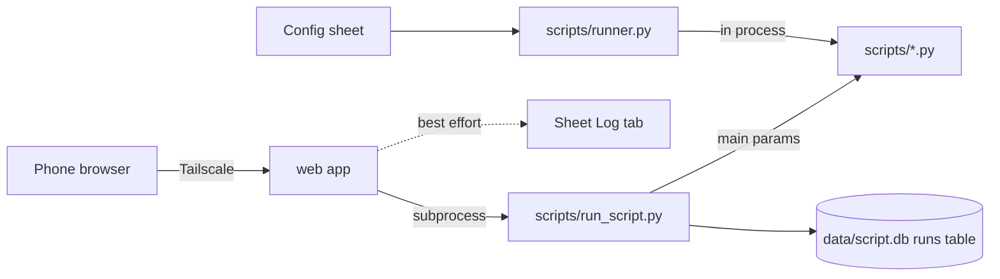

# Web UI (Raspberry Pi Remote Worker)

The web UI is a page for running and watching the task scripts on the Pi, as an alternative to the Google Sheet. It is meant to be used from a phone.

**Status: live.** Installed on the Pi as `remote-worker-web.service` and reached over Tailscale from a phone (2026-11-15; `prime_hunter` ran from the phone). Also runs on a laptop with `python debug_control.py`. Still unchecked: Stop on Linux, the Sheet Log mirror and a reboot.

## Purpose

The Sheet works, but it is slow and indirect: you edit cells, then wait for the runner to poll (every 10 seconds) and write the result back. The web UI sends the command straight to the Pi when you press Run, and shows the result, the parameters and the output on one screen.

It does the same job as the Config sheet:

| Config sheet | Web UI |
|---|---|
| A row per script | A card per script |
| Status (`START`, `RUNNING`, `SUCCESS`, `FAILED`) | A status badge; the Run button replaces setting `START` |
| Last Used, Details | Last run time, last message and details |
| `Parameter-N` cells | Form fields per script, with saved values |
| Log tab | Run history, with the output of each run |
| (none) | Stop button, live output |

The Sheet and its runner keep working unchanged. Either can be used; they are separate front-ends for the same scripts.

## How it fits together



- The web app starts each script as its own process, so it can be stopped and its output read as it is produced. (built)
- The Sheet runner still imports and calls scripts in its own process. (unchanged)
- Both record runs in the script's `runs` table in `data/`, so history is shared.
- Web runs also append a row to the Sheet's Log tab. This is best effort: if the Sheet is unreachable the run and the page are unaffected. (built, not yet checked against the live Sheet)

## What exists now (built)

- **The web app**, in `scripts/web/`: `engine.py` (finding, running, stopping, state), `app.py` (a small JSON API) and `static/index.html` (the page). Run it with `python scripts/web/app.py`, or locally with `python debug_control.py`.
- **State:** saved parameter values and the history of web runs are in `data/pi_control/state.db`; one log file per run is in `logs/`. A lock file in `data/pi_control/locks/` holds the PID of a running script.

- `scripts/run_script.py` runs one script as its own process:
  ```
  python scripts/run_script.py prime_hunter --params '{"start": 1, "end": 50}'
  ```
  It validates the parameters, calls `main(params)`, prints the result, records the run and exits with 0 (succeeded), 1 (failed) or 2 (could not start: unknown script, bad parameters). It refuses `runner` and itself.
- `scripts/utils/params.py` validates and converts parameter values against a script's `PARAMS` list.
- These scripts accept parameters and declare `PARAMS`: `prime_hunter`, `db_report`, `restart_pi`, `pulse_monitor`. `git_pull_update` takes none. `test_connection` still only has its legacy entry point, which `run_script.py` handles.

### Parameters for a script

A script declares what it accepts at module level:

```python
PARAMS = [
    {"name": "start", "label": "Start (inclusive)", "type": "int", "required": True},
    {"name": "mode", "label": "Mode", "type": "choice", "options": ["a", "b"], "default": "a"},
]
DESCRIPTION = "What this script is for, in plain words."
CONFIRM = "Shown in an Are you sure? box before this script runs"   # optional

def main(params=None):
    if params is None:
        ...  # started from the Sheet: read Parameter-N as before
    ...      # started from the web UI: params is a validated dict
    return (success, message, details)
```

Types: `str`, `int`, `float`, `bool`, `date` (YYYY-MM-DD), `choice` (with `options`). Optional keys: `label`, `default`, `required`, `min`, `max`, and `help` (a sentence under the field explaining what it means).

A script also sets `DESCRIPTION`, a plain-language paragraph shown on its card: what it is for, what it changes, and any caveat. Like `PARAMS`, it must be a plain literal because the web UI reads the file without running it. Unknown names, wrong types and out-of-range values are rejected before the script runs. `main()` with no argument still works for scripts that have not been converted. The return value is unchanged.

## Pi health card (built)

The top of the page shows the Pi's current state and a graph, with no Sheet involved:

- **Tiles:** CPU temperature, load, memory used, disk used, uptime and power (throttle) status, read live from the machine. Anything over a limit shows as a warning. Off the Pi most readings are n/a.
- **Sampling badge:** "sampling" when `pulse-sample.timer` is running, "not sampling" when it is not. The timer takes a sample every 5 minutes from boot, installed by `install_web.sh`, and survives reboots. Pulse Monitor is not on the page; the timer runs it with `--sample --no-sheet`.
- **Graph:** the samples stored in `data/pulse_monitor.db` by the timer, for the last 1 hour, 6 hours, 24 hours or 7 days, one of CPU temperature, load, or memory and disk. It fills in as samples are collected.

It replaces the System Health tab and chart in the Sheet. The background timer never writes to the Sheet; only a Sheet-started Pulse Monitor still does.

## Behaviour (built)

- **Script list:** every `scripts/*.py` that defines `main` (or the legacy `test_sheet_connection`), except `runner`, `run_script` and `pulse_monitor` (which runs from the timer, not the page). The files are read, not imported, so `PARAMS`, `CONFIRM` and `TIMEOUT_S` must be plain literal values. Today that is the same set as the Config sheet: `db_report`, `git_pull_update`, `prime_hunter`, `pulse_monitor`, `restart_pi`, `test_connection`.
- **Run:** one tap. Scripts that set `CONFIRM` show an "Are you sure?" box, and the server refuses to run them without confirmation. The values used are remembered per script.
- **Stop:** ends the script and its child processes and records the run as failed ("Stopped by user"). The state shows as "stopped".
- **Output:** shown inside each script's own card, live while running (the page polls), kept per run. Tapping a run in Recent runs opens it in that script's card. The last 20 runs and logs per script are kept.
- **No overlap:** a script cannot be started twice from the web app. A Sheet run is not checked against this (planned).
- **Timeout:** 30 minutes by default; a script can set `TIMEOUT_S`.
- **Looping scripts** run until stopped.
- **Restart safety:** if the web UI restarts while a script runs, the script keeps going and is picked up again on startup (it can still be stopped).

## Access and safety

- Reachable only over Tailscale (or localhost while developing). Never exposed to the internet, no Funnel.
- No password: being on the tailnet is the control. Only one user is assumed.
- Only scripts found in `scripts/` can run; there is no way to type a command. Parameters are validated on the server, and passed to the script as JSON, never through a shell.
- Runs as its own systemd service (`remote-worker-web.service`, draft unit in `scripts/web/deploy/`), separate from `remote-worker.service`. It runs as the same user as the runner and is not sandboxed, because the scripts it starts need passwordless sudo and `credentials.json`.

## Setup (done once; `install_web.sh` repeats it)

On the Pi: `git pull`, then `bash scripts/web/deploy/install_web.sh`. It installs the dependencies, the service and Tailscale, and publishes the page to the tailnet only. Then open the printed `https://<pi-name>.<tailnet>.ts.net` address on the phone.

The commands are in [setup.md](setup.md#8-web-ui-service). Restart it later from the web page itself with `restart_pi`, mode `web`.

## Trying it on a laptop (built)

```
python debug_control.py              # http://127.0.0.1:8051
python debug_control.py --sheet-log  # also write finished runs to the Sheet Log tab
```

It serves `http://127.0.0.1:8051` (localhost only) and reloads when `scripts/web/` changes, like `debug_ui.py` does for the grid dashboard. There is no demo mode: it runs the real scripts on the laptop and records into the real `data/` folder, as the Pi does. On a laptop:

- `restart_pi` does nothing (it only works on Linux).
- `git_pull_update` really runs `git pull --ff-only` in this repository, after the "Are you sure?" box.
- `pulse_monitor` samples the laptop; most readings show n/a on Windows.
- Nothing is written to the Google Sheet unless `--sheet-log` is given. `test_connection` still signs in to the Sheet (read only), because that is what it tests.

## Not part of this

- The public grid dashboard ([grid.md](grid.md)); that is a separate app.
- Notifications on failure, retiring the Sheet, or multiple users.
